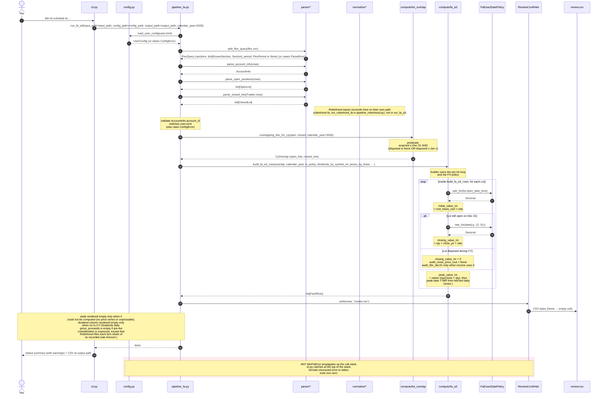

# Architecture & Runtime Flow

Two complementary views of `ibkr-fa`:

1. **Architecture** — what the modules are and what they depend on (static).
2. **Runtime sequence** — the order of calls when
   `ibkr-fa schedule-fa` runs end-to-end (dynamic).

Both diagrams use the same legend:

- 🟢 **green** — done and merged on `main`
- 🔴 **red** — error path / raises an exception
- 🔵 **blue** — external (your inputs / final outputs)

> ℹ️ This document is updated whenever the architecture changes meaningfully.
> Status colors reflect what's on `main` at the time of the most recent
> commit to this file. Open issues are tracked under the
> [`area:*`-labelled tracking issues][trackers] on GitHub.

[trackers]: https://github.com/jay-tau/ibkr-fa/issues?q=is%3Aissue+is%3Aopen+label%3Atracker

---

## 1. Architecture (static view)

```mermaid
flowchart TB

    %%──────────── Style classes ────────────
    classDef done fill:#1a7f37,color:#fff,stroke:#0d4a1e,stroke-width:2px
    classDef err  fill:#cf222e,color:#fff,stroke:#82071e,stroke-width:2px
    classDef ext  fill:#0969da,color:#fff,stroke:#0550ae,stroke-width:2px

    %%──────────── External inputs ────────────
    subgraph INPUTS["📥 You provide"]
        FLEX["IBKR Flex Query CSV<br/>• Open Positions LOT<br/>• Closed Lots<br/>• Account Information"]:::ext
        UTOML["user.toml<br/>account number, holder,<br/>opening date"]:::ext
    end

    %%──────────── Bundled reference data ────────────
    subgraph REFDATA["📚 Bundled in the package ✅"]
        TTBR["reference/<br/>sbi_ttbr_usd_inr.csv"]:::done
        CC["reference/<br/>itr_country_codes.csv"]:::done
    end

    %%──────────── Top-level orchestration ────────────
    CLI["cli.py<br/>argparse app"]:::done
    PIPELINE["pipeline_fa.py<br/>run_fa_a3()<br/>(owns: input-format dispatch,<br/>account_id check,<br/>cross-AY FX-policy check,<br/>required-section enforcement,<br/>manual-fill warnings —<br/>errors propagate to cli)"]:::done

    %%──────────── Config layer ────────────
    CFG["config.py<br/>load_user_config()<br/>↑ raises ConfigError"]:::done
    UCFG["UserConfig"]:::done

    %%──────────── Parser layer ────────────
    subgraph PARSERS["🔍 Parser layer ✅"]
        MULTI["parser/multi_section.py<br/>↑ raises ParseError"]:::done
        OPP["parser/open_positions.py"]:::done
        CLP["parser/closed_lots.py"]:::done
        ACP["parser/account_info.py"]:::done
        DIVP["parser/activity_statement/<br/>dividends.py<br/>parse_activity_statement_dividends()"]:::done
    end

    %%──────────── Input domain models ────────────
    subgraph INMODELS["📦 Input models ✅"]
        OL["OpenLot"]:::done
        CL["ClosedLot"]:::done
        AI["AccountInfo"]:::done
        DIV["Dividend<br/>(symbol, isin, payment_date,<br/>amount_gross, currency,<br/>description)"]:::done
    end

    %%──────────── Normalize layer ────────────
    subgraph NORMALIZE["🧹 Normalize layer ✅"]
        RHN["normalize/robinhood/<br/>reconcile reports, statements,<br/>transfers and quantities"]:::done
        CMAN["normalize/fidelity_cma/<br/>check statements against the<br/>year-end report and Form 1042-S"]:::done
        F1042["normalize/form_1042s.py<br/>shared Form 1042-S gate<br/>and whole-dollar rounding"]:::done
    end

    %%──────────── Compute layer ────────────
    subgraph COMPUTE["🧮 Compute layer ✅"]
        OVL["compute/lot_overlap.py<br/>overlapping_lots_for_cy()<br/><b>predicate:</b><br/>acquired ≤ Dec 31 ∧<br/>(disposed is None ∨<br/>disposed ≥ Jan 1)"]:::done
        IV["compute/initial_value.py"]:::done
        CV["compute/closing_value.py<br/><b>0</b> if disposed in CY"]:::done
        RB["compute/fa_a3.py<br/>build_fa_a3_rows()<br/><i>owns FX policy —<br/>computes init/close per lot</i>"]:::done
        DIVCMP["compute/dividends.py<br/>aggregate_dividends_by_symbol_inr()<br/><i>CY total × Dec-31 TTBR,<br/>HALF_UP applied at writer</i>"]:::done
        STUB1["peak_value_inr<br/>⚙️ native max(close×qty), then<br/>peak-date TTBR (#14)<br/>(else None → empty cell)"]:::done
        STUB2["gross_amount_paid_credited_inr<br/>⚙️ computed from Dividends<br/>(else None → empty cell)"]:::done
        STUB3["gross_proceeds_from_sale_inr<br/>⚙️ proven gross × TTBR(Dec 31)<br/>(None if unproved; 0 if open)"]:::done
    end

    %%──────────── FX layer ────────────
    subgraph FXLAYER["💱 FX layer ✅"]
        FXP["FxPolicy<br/>(Protocol)"]:::done
        FAP["FaExactDatePolicy<br/>exact-date + prior-rate carry-forward<br/>max_carry_forward_days=14<br/>↑ raises MissingFxRateError"]:::done
        FXLOAD["fx/ttbr_loader.py"]:::done
    end

    %%──────────── Errors ────────────
    EXC["exceptions.py<br/>IbkrFaError<br/>• ParseError<br/>• ConfigError<br/>• MissingFxRateError"]:::err

    %%──────────── Output model ────────────
    OR["FaA3Row<br/>11 portal cols + 9 audit cols<br/><b>peak computed from fetched prices (#14),</b><br/>proceeds computed (#16);<br/>paid/credited conditional on<br/>Activity Statement Dividends"]:::done

    %%──────────── Output layer ────────────
    subgraph OUTLAYER["📤 Output layer ✅"]
        OWP["output/base.py<br/>OutputWriter Protocol"]:::done
        REG["output/__init__.py<br/>writer registry, keyed by OutputKey,<br/>+ --format catalog of OutputBindings"]:::done
        RW["output/review_csv.py<br/>ReviewCsvWriter<br/><i>renders None → empty cell</i>"]:::done
        XW["output/xlsx.py<br/>XlsxWriter<br/><i>typed cells + frozen header</i>"]:::done
        LBL["output/portal_labels/<br/>_ay_YYYY_YY.py"]:::done
    end

    %%──────────── External outputs ────────────
    subgraph OUTPUTS["📥 You consume"]
        OUTCSV["schedule_fa_2026_review.csv"]:::ext
        OUTXLSX["schedule_fa_2026_review.xlsx"]:::ext
        PORTAL["incometax.gov.in<br/>ITR-2 portal"]:::ext
    end

    %%──────────── Control flow (CLI → pipeline → modules) ────────────
    CLI ==> PIPELINE
    PIPELINE -.calls.-> CFG
    PIPELINE -.calls.-> MULTI
    PIPELINE -.calls.-> OPP
    PIPELINE -.calls.-> CLP
    PIPELINE -.calls.-> ACP
    PIPELINE -.calls.-> DIVP
    PIPELINE -.calls.-> OVL
    PIPELINE -.calls.-> DIVCMP
    PIPELINE -.calls.-> RB
    PIPELINE -.calls.-> RW

    %%──────────── Data flow ────────────
    UTOML -->|TOML doc| CFG
    CFG -->|builds| UCFG

    FLEX -->|CSV bytes| MULTI
    MULTI -->|"section_name → rows<br/>(via pipeline)"| OPP
    MULTI -->|"section_name → rows<br/>(via pipeline)"| CLP
    MULTI -->|"section_name → rows<br/>(via pipeline)"| ACP
    MULTI -->|"Dividends rows<br/>(Activity Statement only,<br/>via pipeline)"| DIVP

    OPP -->|list of| OL
    CLP -->|list of| CL
    ACP -->|builds| AI
    DIVP -->|list of| DIV
    PARSERS -->|"Robinhood reports<br/>+ statements"| RHN
    RHN -->|"reconciled source evidence"| COMPUTE
    PARSERS -->|"CMA statements, year-end report<br/>+ Form 1042-S"| CMAN
    F1042 -->|"form gate, rounding"| CMAN
    F1042 -->|"form gate, rounding<br/>(Robinhood income)"| COMPUTE

    OL -->|list of| OVL
    CL -->|list of| OVL
    OVL -->|CyOverlap| RB
    DIV -->|list of| DIVCMP
    DIVCMP -->|"dict[symbol → INR total]<br/>(or None for manual fill<br/>via pipeline)"| RB

    RB --> IV
    RB --> CV
    UCFG -->|"entity overrides,<br/>peak basis + currency"| RB
    AI -.->|"account_id checked<br/>by pipeline"| UCFG
    CC -->|country code lookup| RB

    RB -->|list of| OR
    OR -.fills.-> STUB1
    OR -.fills.-> STUB2
    OR -.fills.-> STUB3

    %%──────────── FX flow ────────────
    IV -->|"rate_for(lot.open_date_time)"| FAP
    CV -->|"rate_for(Dec 31)<br/>only if NOT disposed in CY"| FAP
    DIVCMP -->|"rate_for(cy_end)<br/>Dec 31, when totals exist"| FAP
    FAP -.implements.-> FXP
    FAP -->|load_ttbr USD| FXLOAD
    TTBR -->|CSV bytes| FXLOAD
    FXLOAD -->|"dict[date, Decimal]"| FAP

    %%──────────── Error flow ────────────
    FAP -.raises.-> EXC
    MULTI -.raises.-> EXC
    OPP -.raises.-> EXC
    CLP -.raises.-> EXC
    ACP -.raises.-> EXC
    DIVP -.raises.-> EXC
    CFG -.raises.-> EXC
    EXC -.propagates up.-> CLI
    CLI -.formats & exits.-> OUTPUTS

    %%──────────── Output flow ────────────
    OR -->|list of FaA3Row| RW
    OR -->|list of FaA3Row| XW
    RW -.implements.-> OWP
    XW -.implements.-> OWP
    REG -->|"output_binding(FA, 'review-csv')"| RW
    REG -->|"output_binding(FA, 'xlsx')"| XW
    LBL -->|portal column labels| RW
    LBL -->|portal column labels| XW
    RW -->|CSV bytes| OUTCSV
    XW -->|XLSX bytes| OUTXLSX
    OUTCSV -.->|"manual: copy/paste<br/>cell-by-cell"| PORTAL
    OUTXLSX -.->|"manual: copy/paste<br/>cell-by-cell"| PORTAL
```



**Edge styles** in this diagram:

- `-->` solid arrow with a label = **data flow** (the label says what flows).
- `-.calls.->` / `-.raises.->` / `-.caught by.->` dashed arrow = **control flow** or **error flow**.
- `-.implements.->` dashed arrow = **type relationship** (concrete class implements a Protocol).
- `==>` thick arrow = **user-driven entry point** (the CLI command).

**Notes**:

- `gross_amount_paid_credited_inr` attribution has two modes:
  - **First lot** (Activity Statement, StockPlan and Fidelity CMA;
    NetBenefits passes a proven zero): `build_fa_a3_rows` assigns the
    per-symbol INR total (full-precision CY total converted at the Dec-31
    TTBR via `compute/dividends.py`) to the **first lot of that symbol** in
    input order (open lots first, then closed lots). Subsequent same-symbol
    lots get `Decimal("0")`. This preserves the portal-sum integrity (sum
    across rows for a symbol == per-symbol total) without double-counting.
    These sources prove no record dates, so apportionment by holding stays
    deferred under
    [`feat(compute): gross amount paid/credited`](https://github.com/jay-tau/ibkr-fa/issues/15).
    First-lot landed in [PR #137](https://github.com/jay-tau/ibkr-fa/pull/137)
    for Activity Statement inputs.
  - **Pro rata by holding** (Robinhood): a credit whose source proves a
    holding date (`Dividend.holding_date`) is split by quantity across the
    lots held at the end of that date (`held_on`: opened on or before it,
    closed after it), each holder taking its exact rational share
    (`split_a3_credit_by_holding` in `compute/fa_a3.py`, #1243). Each USD share
    converts at the Dec-31 TTBR and files the exact HALF_UP. This is ibkr-fa's allocation policy, not a
    portal rule; see [ADR 0006](decisions/0006-robinhood-multi-account-evidence.md).
    Robinhood fails closed: a credit with no held lot or unreconciled source
    quantity is an A3 credit-attribution blocker (manual fill), and an in-CY
    dividend whose record date precedes US T+1 settlement (May 29, 2024) has
    no holding date and raises `RobinhoodFaError`.
- The pipeline (not the dataclasses) owns the
  `AccountInfo.account_id ↔ user.toml` cross-check. The static diagram
  shows this with a dashed informational arrow, not a method call.
- The architecture diagram routes parser data flows through the pipeline
  (the **pipeline** invokes `multi_section.split_flex_query` and then each
  section parser separately on the result). This matches the sequence
  diagram below.

---

## 2. Runtime sequence (dynamic view)

The command:

```bash
ibkr-fa schedule-fa --input flex.csv --calendar-year 2026 \
                    --config user.toml --output review.csv
```



---

## Adding a new input source (contributor guide)

The **core schedule engines and output writers are source-neutral** (this is
what #355 formalised): they consume the shared input models — `OpenLot`,
`ClosedLot`, `Dividend`, `WithholdingTax`, `InterestCredit`, `AccountInfo` —
regardless of which broker they came from. A "source" (IBKR, Fidelity
NetBenefits, any future brokerage / RSU export) therefore only has to get its
export **into those shared models**; everything downstream is reused.

Two shapes exist today:

* **IBKR** parses directly into the shared models and bundles them as a
  frozen `SourceBundle` (`models/source.py`), fed straight to the engines.
  Before building it, the dispatcher checks the coverage the file states
  against each report (`compute/source_coverage.py`).
* **NetBenefits** parses source-specific evidence (`EspLot` / `EspClosedLot`
  / `EspPurchase`) and passes it to a small **adapter** that converts it to
  the shared models before the engines — e.g.
  `compute/espp_capital_gains.py` takes `EspClosedLot` + `EspPurchase`, builds
  `ClosedLot`s with the §49(2AA) historical INR cost as
  `cost_basis_inr_override`, then calls the shared CG engines.

To add a source (e.g. E\*TRADE, a standalone RSU export):

1. **Parse the export.** Write a parser under `parser/<source>/`. Produce the
   shared models directly (IBKR-style) OR your own source-specific records if
   the raw evidence needs an adapter (NetBenefits-style). Whatever the engines
   ultimately see must be the shared models. A held lot whose Dec-31 value the
   export doesn't state becomes a `HoldingLot` (`models/holding_lot.py`), which
   `compute/holding_valuation.py::value_holding_lot` turns into an `OpenLot`;
   `tests/test_openlot_construction_sites.py` refuses new direct `OpenLot(`
   call sites.

   Every number read from an input goes through `number_checks` (#1275):
   right after the reader's own shape, finite and sign checks, call
   `number_limit_breach(value, kind)` and raise the layer's own error with
   the text it returns (it names no value). Each kind has two limits, digits
   before the decimal point and digits after it, set well above anything a
   real input prints:

   | Kind (`NumberKind`) | Covers | Whole digits | Decimal places |
   |---|---|---:|---:|
   | `QUANTITY` | shares, fund units, contracts, shares lent | 12 | 20 |
   | `MONEY` | USD amounts; INR amounts in `user.toml` | 15 | 20 |
   | `PRICE` | unit prices, option strikes, dividends per share, fetched closes and highs | 9 | 20 |
   | `RATE` | rates and percents | 3 | 6 |
   | `FX_RATE` | TTBRs | 3 | 4 |

   The Robinhood, NetBenefits and Fidelity CMA readers, `user.toml` and the
   CLI's USD flag call it (#1275), and so do the IBKR Activity Statement and
   Flex readers, the StockPlan reports, the TTBR loader and the price readers:
   Yahoo, Nasdaq, Massive and the price cache, locked or not (#1276). A reader
   checks every number it parses or matches by shape, including ones it only
   cross-checks (printed totals, `Change in NAV` fields) or never keeps.
   Split ratios and Massive's volume, count, timestamp, strike and multiplier
   aren't checked. Derived values (products, sums, exact shares) keep the
   1,000-digit backstop in `compute/exact_inr.py`. A parser's own derived
   values and cross-checks are exact too: parsers can't import `compute`, so
   they keep every digit with `parser/_exact.py` (#1311), as the IBKR Trades
   net proceeds, Open Positions reconciliation and Flex closed-lot proceeds
   and `PositionValue` check do.
2. **Reuse the compute layer — do NOT write new tax logic.** Feed the shared
   models into the existing engines: `build_fa_a3_rows` (Schedule FA),
   `compute_schedule_cg_stcg_lines` / `compute_schedule_cg_ltcg_lines`
   (Schedule CG), and `compute_income_schedules` +
   `compute_schedule_tr_from_fsi` (the assembler builds the Schedule OS / FSI /
   Form 67 results; Schedule TR then derives from its FSI result). If your
   source has a statutory INR cost of acquisition (e.g. RSU/ESPP §49(2AA)
   FMV), set it on each `ClosedLot` as `cost_basis_inr_override`; the engines
   file it in place of the Rule 115 conversion. Don't edit engine output
   afterwards, extend the ESPP adapter, or fork the §112 / Rule 115 engines.
3. **Reuse the output writers.** The CG/OS/FSI/… writers are source-agnostic.
   A new source registers no writers; it emits under the existing catalog
   slots, `(Subcommand, format_id)` (add the subcommand name to
   `_non_writer_subparsers` in `tests/test_output_registry.py`). A new writer
   registers under its own key with `@register(OutputKey(destination,
   artifact))` and gets a catalog entry in `output/__init__.py` binding its
   slot to `OutputBinding(key, writer)`, or none for a key-only destination
   (CBDT JSON, Quicko). The catalog is the one declaration of which slots
   exist and what renders each; a binding never reads the payload, so looking
   one up evaluates no rows ([ADR-0022](decisions/0022-output-bindings.md)).
   A portal file a shared renderer serves has no writer class: its slot binds
   a key no writer registers to `PortalCsv(rows, dialect)`
   (`output/filing_csv.py`, #1201) or `FilingXlsx(sheets)`
   (`output/filing_xlsx.py`, #1202). `rows` and `sheets` are the schedule's
   functions in `output/schedules/` (Schedule FA's A2 and A3 uploads,
   Schedule OS's filing CSV and workbook, the Form 67 upload, #1203,
   Schedule FSI's and TR's filing worksheets, #1204, and the Schedule CG
   filing workbook, #1205, so far). Building the run's writer passes the
   function the run's context. Writing calls what it
   returned with the computed result before staging the file or creating the
   workbook, so a refusal it makes then comes first (FSI and TR check relief
   there); the rows or sheets it returns are built only as they are read.
   Form 67's is a generator, so its readiness checks run once the file is
   staged, before the header. The `CsvDialect` fixes the encoding, the line
   ending and the formula-check scope. The CSV renderer
   stages the file, checks and writes each row, and publishes the file after
   the last one. The workbook renderer builds each sheet, a `FormSheet` of
   text rows shared with a CSV, a `TableSheet` of a note, a header and rows,
   or an `EntrySheet` of three notes, a blank row, a header and rows,
   checking each row before it appends it. It then saves the workbook to a
   staging file and publishes it.
   The same declaration routes them
   ([ADR-0023](decisions/0023-command-formats-and-selections.md)): a new
   command lists its `--format` choices and default in `_COMMAND_FORMATS` and
   reads them with `command_formats(command)`; outputs it writes whatever
   `--format` says come from a selection (`INCOME_FILING`, `INCOME_REVIEW`,
   `CG_FILING_WORKBOOK`, `OS_FILING_WORKBOOK`). Support isn't exposure: list
   only the formats the command writes. Selections choose what a run writes,
   never what it removes: filenames, historical cleanup targets, promised
   files, preflights and the `remove_outputs_on_failure` window stay explicit
   in the workflow.
   List the outputs as
   `spec_for(Subcommand.X, format_id, payload, path)` and write them with
   `write_output_bundle(specs, RenderContext(...))` (`output/bundle.py`,
   which looks each slot's binding up again as it writes) inside the run's `remove_outputs_on_failure` window. Income outputs
   (Schedule OS / FSI / TR / Form 67) use `write_income_outputs`
   (`output/income_bundle.py`) instead, which picks the files from the
   Form 67 readiness and `--debug`.
4. **Add a thin pipeline + CLI subcommand per schedule.** Mirror
   `pipeline_netbenefits_cg.py`: discover the source's inputs → call the
   compute/adapter (which produces the schedule result) → write the CSV →
   return a report. Register a `<source>-<schedule>` subcommand in `cli.py`
   (mirror `_run_netbenefits_cg`), and optionally a one-shot `<source>-all`
   orchestrator (mirror `_run_netbenefits_all`). The report carries the
   run's `RunOutputs`. The handler renders the report in their
   `removed_on_failure()` scope, then prints and flushes it with
   `_print_report`, after its domain-error `except`, in that scope again. A
   report that fails to render, print or flush attempts to remove every
   output of the run, so a broken pipe that would only show at exit also
   attempts to remove the outputs; if a removal fails too, the run refuses with that
   `OutputRemovalError` (`the run failed, and its output may still be there:
   …`) instead (#832, #1227, #1236).

**Never-be-wrong reminders.** A parser MUST raise `ParseError` on any
ambiguity, malformed layout, or failed cross-check — never fabricate, default,
or silently normalise a filed figure. A refusal echoes no input through its
exception chain either. An `InvariantError` keeps only its context keys and the
`int` value of a position key such as `line`, never another value: `require()`
and `invariants.invariant_error` drop the rest when they build it (#1252).
`raise … from None` only hides the handled exception:
it stays attached as `__context__`, holding a decode error's bytes, a TOML
error's quoted key (and on Python 3.14 the whole document) or, on 3.14, a bad
date's year, month and day. So a parser refuses after the `except` block has
ended (`contextlib.suppress`, or a recorded message and one `raise` after the
`try`), and its no-echo tests walk the whole exception graph, every `__cause__`
and `__context__`, suppressed or not (`tests/_crash_reports.py`'s
`assert_prints_no_marker`). When the caught error is a crash rather than a
domain error, such as a calendar `ValueError`, a month `KeyError` or one of
openpyxl's errors, the refusal raised after the handler keeps one link: a
`ReplacedCrashError` cause naming only the crash's class and innermost `ibkr_fa`
line (`exceptions.crash_site`), so `IBKR_FA_TRACEBACK=1` still re-raises it. The
shared Flex date helpers, the Open Positions side, the Activity Statement
splitter, dates, Period and Trades date/time, and the StockPlan title dates and
workbook reader do this (#1226). `ParseError` is a frozen dataclass, so these
sites raise after the handler instead of through `raise_replacing`, which clears
the replacement's context. The issuer-country guard checks membership in the
country table instead, so it has no caught error to chain; #1368 kept that
check on purpose after the lookup's own error stopped keeping the code. The
workbook reader's one remaining input is the supplied path, in an errno
refusal's suppressed `OSError` context. On Python 3.14 a calendar or clock
`ValueError` can name the year, month and day, or the bad hour, minute or second;
on 3.12 and 3.13 it names none. So these sites' tests search for the date's
parts on every runtime, where only 3.14 can find them, and also require no
context and no cause but the stand-in, which catches a reverted site on 3.12 and
3.13. A relay that replaces one failure with another
keeps none of it either: the Robinhood F&O warning wrapper, `robinhood-all`'s
leg-cleanup refusal, the cleanup relay of `remove_outputs_on_failure` and
`ClaimedOutputCleanup`, and staging-file cleanup (#1211). These relays can't
just raise after their own `except`: they raise in a `with` block's exit, or
under a caller's `except`, where Python attaches the exception being handled as
`__context__` all the same. So they raise through `exceptions.raise_replacing`,
which leaves the replacement no context. Its only link, when the replaced
failure or active handler was or chained a crash, is a `ReplacedCrashError`
cause naming that crash's class and innermost `ibkr_fa` line, so `IBKR_FA_TRACEBACK=1` still
re-raises it. A caller that reported the replaced failure from the chain now
has only the replacement: `robinhood-all`'s CG line no longer says why a write
failed when the writer's own removal failed too. The identity-source refusals
that replace a content-bearing caught error (`robinhood_identity_sources`,
#1222) raise through `raise_replacing` too, so none keeps a CIK-bearing URL,
fetched or cached bytes, a JSON document, a flag, a timestamp or a path through
a fingerprint folder, whose name is derived from the holdings. So do the
GLEIF cache and fetch refusals (`robinhood_legal_entity_sources`, #1224): none
keeps an ISIN- or LEI-bearing URL, an HTTP error's reason or headers, response
or cache bytes, a JSON document, or a path through the ISIN's or LEI's
fingerprint folder, anywhere in its exception graph. The price-cache
and Massive refusal handlers covered by #1225 also raise through
`raise_replacing`, so none keeps a cache, lock, artifact or staging path whose
name is derived from a holding or contract, a contract-bearing request URL, a
transport reason or headers, decoder bytes, a JSON document or a cached
timestamp. Yahoo's not-JSON refusal and the TTBR loader's row refusal are
frozen dataclasses, whose context `raise_replacing` can't clear, so each keeps
only the stand-in in its handler and raises after it; under a caller's `except`
its context is that caller's exception. Nor does a refusal chain an exception
that holds a `resolve()` form of a path or a link's target, which the user
never typed: `Path.resolve()`'s `OSError` (or its symlink-loop `RuntimeError` on
Python 3.12), `relative_to`'s `ValueError` quoting both resolved paths, or an
`OSError` from opening a resolved path. The Robinhood bundle raises resolve and
read refusals after suppression ends and checks containment with `is_relative_to`
(#1248). The output-collision check refuses an input path it cannot walk after
its handler, chaining nothing, since the walk's `OSError` can name an entry that
`absolute()` or a link's target built (#1623).
Where a `False` from `Path.exists()`,
`is_dir()` or `is_file()` could skip an input, take a default or name the wrong
problem, use `ibkr_fa.path_checks` instead: on Python 3.14 those return `False`
for any `OSError`, `EACCES` included, where 3.12 and 3.13 raise it, so a path in
a folder that can't be searched reads as missing (#838, #1238). The helpers
raise it on every version; a missing entry, a file on the way, a symlink loop
or an invalid path still reads as absent. A cache lookup uses `may_exist`, so
an artifact it can't inspect is read and refused, not fetched over. An input
folder is walked with `os.walk(onerror=…)`,
not `rglob`, which skips a folder it can't read. A new pipeline SHOULD clear its output
target(s) **before** any fallible work so a refused run leaves no stale file,
after `output._cleanup.refuse_input_collisions` has checked every target it may
delete against the config and every input file (#673) —
`pipeline_netbenefits_cg.py` and the `netbenefits-all` orchestrator do this;
`netbenefits-fa` / `-income` are older and clear only after some fallible work
(a known wart the orchestrator compensates for by pre-clearing every target,
see #360).

**Worked example — Fidelity NetBenefits:** `parser/netbenefits/`,
`pipeline_netbenefits_{fa,income,cg}.py`, the `netbenefits-{fa,income,cg,all}`
subcommands in `cli.py`, tests in `tests/test_pipeline_netbenefits_*.py`.

**Support-contract example — Morgan Stanley StockPlan:** `parser/stockplan/`
parses dividends straight into the shared models and vests into
source-specific `StockplanVest` records. `compute/stockplan_positions.py`
reconciles the vests to the Holdings report and turns them into `HoldingLot`s. [`docs/stockplan-contract.md`](stockplan-contract.md) is
the source's contract: every accepted sheet, row, column and value, every
cross-report check, refusal and warning, the outputs, exit codes and cleanup,
and which of it a real export has verified. A PR that changes any of these
updates that page, following its maintainer checklist.

**Two-account evidence example — Robinhood:** `pipeline_robinhood_bundle.py`
discovers two configured reports, separates Crypto statements, reconciles
reports to statement accounts by evidence and proves transfers through
`normalize/robinhood/`, and exposes one shared bundle. The readers' own checks
are exact (#1295): the activity CSV's dividend and ADR-fee check rounds the
exact shares times rate to cents, and the statement's total, running-balance
and row market-value checks add and multiply with every digit
(`parser/_exact.py`). So do the normalizer's sums, identities and bands
(#1308): its cash and Deposit Sweep identities, loaned-securities partition,
holdings total, per-security quantities, quantity bands, movement quantities
and replay keep every digit. `pipeline_robinhood.py`
computes CG, income/FTC, FA, and options as independent legs, with
`compute/robinhood_lots.py` matching lots by original-date FIFO per account.
A sale split pro rata across same-day lots bought at the same unit price gives
each lot an exact rational share of its cost (#1241) and of its quantity
(#1263): the quantity each lot gives up and the quantity it keeps stay exact
beside their 20-digit Decimals, so a later take, the sale's cash split and
Schedule FA A3's closing, credit and peak values use the exact
quantities. The same-day unit-cost test compares the exact costs and
quantities too (#1326), so a later partial sale over a split group can split
it pro rata again.
Cross-layer reuse is expected: inventory owns the exact global event partition,
while income/CG/options are exact over their own event kinds. `robinhood-all`
clears exact targets, writes valid legs independently, and reports manual versus
hard blockers without treating a legitimate cross-layer consumer as a duplicate.

**Deliberately NOT built (YAGNI):** a plugin registry, entry-point discovery,
or an abstract `Source` base class. With all sources in-tree, a parser + the
shared models is the entire contract; add discovery only if a source ever
ships out-of-tree.

---

## Portal artifact parity (#1199)

The eight portal-entry artifacts are the files a filer types or uploads into
the ITR portal: the FA A2 and A3 filing CSVs, the Schedule OS filing CSV and
workbook, the Schedule FSI and TR filing CSVs, the official Form 67 CSV and the
combined Schedule CG filing workbook. Every change to how they are rendered
must keep each byte, stream and exit code the same. The tests below compare
against a fixed baseline. Comparing two runs of the code under test is not
baseline parity.

**Baseline and provenance.** `tests/fixtures/portal_parity_baseline.json` holds
one record per case. Its `provenance` names the commit the records were
captured from (6c20527) and the commit they were checked against (612f2be;
no commit between the two changed `output/` code). It also names the Python,
openpyxl and zlib versions used. The records were captured once:
- The tests' own record functions ran on a `git archive` of that commit, with
  only the parity test files added.
- A scratch plugin that is not in the repo recorded the results instead of
  comparing them.

#1203 added four `form-67` and `netbenefits-income` command records, captured
the same way from 6c20527; that capture also reproduced every earlier command
record. The tests only read the file. A deliberate output change needs the
owner's approval and a new capture, reviewed like code.

#1289 re-captured the `schedule-fa/filing-csv` and `run-all` command records the
same way on its own branch, with the owner's approval, when Table A3 stopped
filing a country name as the issuer's address. In each, only the A3 file's
three `Address of entity` cells (now blank) and the new manual-fill lines
changed. The same capture on main reproduced both old records, and every other
record is unchanged, so `provenance` still describes those.

#1359 re-captured the `schedule-tr/filing-csv` command record the same way on
its own branch, with the owner's approval, when Schedule TR's LEFT BLANK
summary and advisory lines dropped the "no positive relief" reason. Only
`stdout[12]` and `stderr[2]` changed; the exit code and output file did not.
The same capture on main reproduced the old record, and every other record is
unchanged.

#1363 re-captured six command records the same way, with the owner's approval,
when the always-zero `    non-ordinary distributions: 0` line left the Schedule
TR and Form 67 reports: `form-67/blank`, `form-67/fractional-rates/blank`,
`form-67/fractional-rates/ready`, `form-67/portal-csv`, `run-all` (two lines)
and `schedule-tr/filing-csv`. In each, only stdout lost that line. The same
capture on main reproduced all six old records, and every other record is
unchanged.

#1360 re-captured 58 records the same way on its own branch, with the
owner's approval, when each Robinhood Schedule CG section gained its five
Table F date bands: every `schedule-cg-filing-xlsx` record except the four
`empty/*` ones, and the `robinhood-cg/debug` and `robinhood-all` command
records. The same capture on main reproduced all 105 records. A cell-by-cell
comparison of the two captures' workbooks and streams found only the added
`F3`/`F5` rows, "item F" becoming "Table F" in the A5(e)/A6(g) Basis, the
zero bands named in each sheet's omitted-fields note, the auto-filter range
those rows extend, and the Table F words in `robinhood-cg/debug`'s
`Action:` line. Every other record is unchanged.

#1361 re-captured four command records the same way on its own branch, with
the owner's approval, when every Schedule CG review CSV and XLSX gained its
Table F block before the audit TOTAL: `run-all`, `fidelity-cma-cg`,
`netbenefits-all` and `robinhood-cg/debug`. The same capture on main
reproduced all 105 records. In each of the four, only the two CG review CSVs
changed, and each one equals main's once its block (the blank row, the
`_table_f:` marker, the five bands and the note) is removed; the exit codes
and streams did not change. Every other record is unchanged.

#1379 re-captured 33 records the same way on its own branch, as the issue
asked, when a blank Table F row's Basis in the Robinhood Schedule CG
workbook gained the completion guidance a computed row's Basis gives: the
`robinhood-cg/debug` command record and every mode of eight
`schedule-cg-filing-xlsx` cases (`accounts-sharing-a-label`,
`one-unproven-lot-blanks-section`, `proven-ltcg-beside-unproven-stcg`,
`rounded-zero-stcg-balance-manual`, `unproven-both`, `unproven-ltcg`,
`unproven-sales-named-once` and `unproven-stcg`). The same capture on main
reproduced all 105 records. A cell-by-cell comparison of the two captures'
workbooks and streams found only blank `F3`/`F5` rows' Basis cells changed,
each from its blank reason to that reason followed by the guidance; the
exit code and streams did not change. Every other record is unchanged.

#1383 re-captured 42 records and deleted 16 the same way on its own branch,
as the issue asked, when Robinhood's recorded sale Amount became each sale's
full value of consideration with 0 transfer expenditure. That touched every
`schedule-cg-filing-xlsx` record except the four `empty/*` ones, and the
`robinhood-cg/debug` and `robinhood-all` command records. No section is left
for manual entry any more, so of the eight scenarios that built one, four
built exactly another scenario's lots and were deleted with their 16 records
(`unproven-stcg` was `component-rounding-note`, `unproven-ltcg` was `ltcg-loss`, `unproven-both`
was `both-sections`, and `accounts-sharing-a-label` was `stcg-loss` sold from
another account, which the workbook no longer names; each deleted scenario's
lots write its twin's bytes). The other four were renamed for their lots:
`one-unproven-lot-blanks-section` to `stcg-losses-in-two-bands`,
`proven-ltcg-beside-unproven-stcg` to `both-sections-rounding-note`,
`unproven-sales-named-once` to `split-sale-and-another-sale` and
`rounded-zero-stcg-balance-manual` to `rounded-zero-stcg-balance`. The same
capture on main reproduced all 105 records. Main with every test lot proven
(its own filled-section path) differs from main only in those eight
scenarios' 32 records and `robinhood-cg/debug`. A cell-by-cell comparison of
that capture with the branch's, paired through the deletions and renames,
found only each section sheet's tax position note gaining the filing
position, and the (a)(ii) and (b)(iii) Basis texts pointing to it; the same
comparison fails with its sides swapped. Every other record is unchanged.

#1385 added two command records, `fidelity-cma-fa/filing-csv` (the default
config, exit 3) and `fidelity-cma-fa/filing-csv/attested` (an attested upper
A2 peak bound, exit 0), when `fidelity-cma-fa` gained the Schedule FA upload
files. They were captured the same way on its own branch, because earlier
commits don't offer the format. Each record's two files equal what 58f9f29's
shared renderer writes for the same rows, with only the command's format
choices widened. The same capture on main reproduced all 89 earlier records,
and the rebuilt file is main's plus the two new records.

#1427 re-captured seven records the same way on its own branch, as the issue
asked, when the last clause of the shared "INDIAN TAX CALCULATION REQUIRED"
warning came to name every override a Schedule FSI Other Sources row needs:
the `schedule-fsi/filing-csv`, `schedule-tr/filing-csv`, `form-67/blank`,
`form-67/fractional-rates/blank`, `netbenefits-income` and `netbenefits-all`
command records, and the `fsi/manual-fill` writer record. The same capture on
main reproduced all 41 command and writer records. In each of the seven, only
that clause changed, in the Schedule FSI filing CSV's "Manual fill guidance"
cell or in a stream: with main's clause put back, every file and stream
equals main's, and the exit codes did not change. Every other record is
unchanged.

#1446 re-captured the same seven records the same way on its own branch,
with the owner's approval, when that clause dropped its last part, which
said a country with reviewed Robinhood stock-lending fees must be filled by
hand. The same capture on main reproduced all 41 command and writer
records. In each of the seven, only that clause changed: with main's clause
put back, every file and stream equals main's, and the exit codes did not
change. Every other record is unchanged.

#1447 re-captured the `form-67/fractional-rates/ready` command record the
same way on its own branch, with the owner's approval, when a fractional
filed Form 67 `Rate(%)` in the upload `form-67.csv` became manual work: its
`exit_code` went from 0 to 3. The same capture on main reproduced all 26
command records. The re-captured record differs from main's only in
`exit_code`; its stdout, stderr and `form-67.csv` are unchanged. The rebuilt
file is main's with that one record replaced. Every other record is
unchanged.

#1453 re-captured the `fidelity-cma-income` and `fidelity-cma-income/debug`
command records the same way on its own branch, with the owner's approval,
when a blocked Fidelity CMA FTC came to withhold the header-only
`form-67.csv` and write `form-67-debug.csv` in its place. The same capture on
main reproduced all 26 command records. In both records `form-67.csv` left
the outputs and the first stdout line names the debug file and why the
official file was withheld; `fidelity-cma-income` gained `form-67-debug.csv`,
with the bytes the `--debug` record already pinned. The exit code, stderr,
the other stdout lines and every other file are unchanged. The rebuilt file
is main's with those two records replaced. Every other record is unchanged.

#1471 re-captured the same two `fidelity-cma-income` command records the same
way on its own branch, as the issue allows, when the blocked-FTC warning came
to name the `[[fidelity_cma.us_tax_years]]` keys that clear it. The same
capture on main reproduced all 26 command records. In both records only the
first stderr line changed: it is main's warning followed by that remedy. The
exit code, stdout and every file are unchanged. The rebuilt file is main's
with those two records replaced. Every other record is unchanged.

#1555 re-captured seven records the same way on its own branch, as the
issue asked, when the Robinhood B8/B9 (e) note named section 54F instead of
section 54: the `robinhood-cg/debug` command record and the `--debug` modes
of `ltcg-loss`, `both-sections` and `both-sections-rounding-note` in both ITR
forms, the only records whose workbooks print that note. The same capture on
main reproduced all 86 records the parity and Schedule CG golden modules
write. A cell-by-cell comparison of the two captures found only that note
changed, one cell in each of the seven workbooks; the command's exit code and
streams did not change. The rebuilt file is main's with those seven records
replaced. Every other record is unchanged.

**Records.** A file record is its SHA-256 and size. A ZIP package (an XLSX)
also lists its members in order, each as name, CRC-32 and size. A command
record is its exit code, its stdout and stderr as lines that keep their line
endings (with the tmp path written as `<tmp>`), and the record of every file
under its output folder, hidden staging files included.

**Controlled time.** Workbook bytes depend on three clock reads: openpyxl's
created time, its modified time, and the time `zipfile` stamps on each member.
`tests/_portal_parity.py:fix_xlsx_clock` sets all three to one fixed instant in
the test process. Missing clock attributes fail immediately; complete
workbook-byte comparisons catch unpatched clock reads. Production code is
unchanged.

**What each check proves:**

| Check | Where | Proves |
|---|---|---|
| Portal CSV bytes | `tests/test_portal_parity_writers.py` | Empty, populated and supported manual-fill output of the FA A2/A3, FSI and TR (with and without the Quicko block) writers is byte-identical: encoding, BOM, line endings, quoting, labels and blanks. Form 67 has empty and populated byte cases; incomplete portal rows are refused. |
| Workbook bytes | `tests/test_schedule_os_output_pins.py`, `tests/test_schedule_cg_filing_golden.py` | Seven OS filing-workbook cases (six statements plus a hand-built result), and all 44 CG cases (11 scenarios in both ITR forms, with and without `--debug`), match the baseline byte for byte under the fixed clock. That covers cell values and types, number formats, styles, dimensions, panes, sheet names and order, print settings, document properties and package structure. Each workbook's `docProps/core.xml` must also equal the complete file in `CORE_PROPERTIES`. |
| Package members | the same | Workbook comparisons first check the complete core properties, then compare the member list (name, CRC-32, size) before the whole-file digest, so a member mismatch names the member that changed. If every member matches, only the compression or ZIP headers differ, for example under another zlib build. CI's zlib 1.3.1 and 1.3.2 compress identically; zlib-ng does not. The semantic workbook digests stay as the readable diagnostics. |
| Commands | `tests/test_portal_parity_cli.py` | For the listed command cases, the exit code, stdout, stderr and complete set of output files match, byte for byte. The commands are: IBKR `schedule-fa`/`schedule-os`/`schedule-fsi`/`schedule-tr` in their filing formats, `form-67` (ready, blank and refused, and with two fractional rates, blank and ready), `run-all`, `netbenefits-fa`/`-income`/`-all` (`-income` also with a refused Form 67 row, and with the Quicko block in its Schedule TR file), `stockplan-income` and `fidelity-cma-income` (with and without `--debug`), `fidelity-cma-cg`, `fidelity-cma-fa` in `filing-csv` (with the default config and with an attested upper A2 peak bound), and `robinhood-cg`/`-income`/`-all`. Robinhood has no synthetic bundle, so its cases stub loading and compute and run the real writers. |
| Targets and failures | `tests/test_portal_parity_writers.py`, `tests/test_output_xlsx_atomic.py` | Each writer replaces an existing file or symlink with the baseline bytes at mode 0600. A failed replace or workbook save keeps the old target and leaves no staging file. Each kept safety refusal keeps its type and message, and whether it fires before or after the staging file exists. |
| Order | `tests/test_portal_parity_writers.py` | Logged row pulls, staging, writes and publication pin the order of projection, checking and publication. FA, TR and Form 67 project, check and write one row at a time without reading ahead; Form 67 first reads every entry for its readiness checks. FSI pulls every row for its relief check and its grouping pass before the first write. Workbook construction refusals fire before a staging file exists. Mixed failures pin which refusal wins: for the FA uploads (#1201), a row's country check comes before its `.filed` amounts, which come before its text checks; a NUL byte wins over a formula trigger in an earlier cell; and an earlier row's safety refusal wins over a later row whose projection would refuse, which is never read. An FA payload given as a generator gives the baseline bytes. Both OS artifacts (#1202) check each ITR row before projecting the next, so a row's safety refusal wins over a later row's projection failure. They project every Quicko entry after the ITR rows and before the first Quicko row, sheet or account split. The CSV never asks for the account split: with one dividend line's account unknown it writes the same bytes, while the workbook refuses before staging. For the Form 67 upload (#1203), readiness runs once the file is staged and wins over the header check and every row; in a row the country Others refusal comes before the country-code match, then the source Others refusal, then `.filed`, whose amounts, rates and article number refuse in column order; a NUL byte wins over a formula trigger in the same cell; and an earlier row's safety refusal wins over a later row's projection, which never runs. FSI and TR check relief before staging, ahead of any row's cell checks, and only TR builds the run's Quicko block, after its last row (#1204). The income bundle checks FSI's relief, then TR's, then chooses its files, all before staging the first one. The CG workbook (#1205) checks the run's context before it resolves the AY's labels, when its writer is built, and its blockers before it projects either section, when it writes. It reads no account labels (#1383), so a run with none writes the baseline bytes. |

Owner-data comparisons belong to each production cutover, not to this
synthetic baseline.

---

## FX policy by Assessment Year

This section catalogues the **statutory FX-conversion provisions** that
govern each Schedule the tool produces, indexed by the Income-tax regime
that applies. The source-of-truth rule text is quoted **verbatim** so
that future-AY migrations have a single anchor; commentary follows each
quotation.

> **Why this matters.** The FX policies in `compute/` (e.g.
> `fx/policy_rule115.py`) hardcode rates, dates, and authorities that
> come straight from the rule text. Changing any of those without
> updating the policy modules would silently desynchronise the engine
> from the law. Sub-issues 2-4 of #126 (AY 2027-28+ migration epic)
> depend on this section being accurate.

### A. AY 2024-25 through AY 2026-27 — Income-tax Act, 1961 + Income-tax Rules, 1962

For tax years up to and including FY 2025-26 (i.e. AY 2026-27 — the last
year before the Income-tax Act, 2025 takes over), FX conversion is
governed by **Rule 115 of the Income-tax Rules, 1962**. The tool's
`Rule115Policy` family (`src/ibkr_fa/fx/policy_rule115.py`) implements
this rule.

The 1962 Rules' Rule 115 text and its CBDT-published "specified date"
table for each head of income remain authoritative for AY 2026-27 (the
current working AY for which `ibkr-fa` produces forms). The policy
modules cite the [Income Tax India portal][rule115-1962] for the
verbatim rule and quote per-head specified dates in their docstrings.

For **Schedule FA disclosure cells** (Initial / Peak / Closing balance
and foreign-source income),
the 1962-Rules regime does **not** prescribe a Rules-level FX rule;
conversion is governed by the **ITR-2 form instructions** issued by
CBDT each AY, which prescribe **SBI TTBR on the relevant per-column
date** (acquisition date for initial; date of peak balance for peak;
31-December for closing and foreign-source income). This matches the
methodology in `compute/fa_a3.py` and `compute/dividends.py`.

[rule115-1962]: https://incometaxindia.gov.in/Pages/rules/income-tax-rules-1962.aspx

### B. AY 2027-28 onwards — Income-tax Act, 2025 + Income-tax Rules, 2026

The **Income-tax Act, 2025** takes effect from **1 April 2026** and
governs tax year 2026-27 onwards (i.e. AY 2027-28 onwards). The
**Income-tax Rules, 2026** were notified by the CBDT vide
**G.S.R. 198(E) dated 20 March 2026**, under powers conferred by
section 533 of the Income-tax Act, 2025, with effect from **1 April
2026**.

The Rule 115 analog in the 2026 Rules is **Rule 206** (income FX
conversion). The Rule 26 (TDS FX) analog is **Rule 207**, which also
carries the canonical **TTBR definition** referenced by Rule 206.

#### Rule 206 — Income FX conversion (verbatim)

> _Note: two editorial annotations appear inside the block quote, both
> introduced by `[sic — …]`: (a) the self-reference in sub-clause (ii)
> ("income referred to in sub-clause (ii)"); and (b) the "month of in
> which" phrasing in Sl. No. 6 of the Table. Both flag drafting typos
> **verified verbatim against the official CBDT PDF text-extract** (see
> "Source" paragraph below). The bracketed `[Table: Sl. No. 3]` in
> sub-rule (3) is in the gazette text itself (not editorial; the
> gazette renders it as `[Table:Sl.No. 3]` with collapsed whitespace).
> The bold emphasis on the TTBR definition in Rule 207 below
> is editorial. The substantive wording is reproduced as gazetted; see
> the linked sources for the unannotated text._

> **Rule 206 — Rate of exchange for conversion into rupees of income
> expressed in foreign currency.**
>
> (1) The rate of exchange for the calculation of the value in rupees
> of any income, accruing or arising or deemed to accrue or arise to
> the assessee in foreign currency, or received or deemed to be
> received by him or on his behalf in foreign currency, shall be the
> telegraphic transfer buying rate of such currency as on the
> specified date.
>
> (2) For the purposes of this rule—
>
> (a) "telegraphic transfer buying rate" shall have the meaning
> assigned to it in rule 207; and
>
> (b)
>
> (i) the "specified date" in respect of the nature of income referred
> in column B of the following Table shall be as given in column C:
>
> **Table**
>
> | Sl. No. | Types of Income (B)                                                                                                                                                                                                                                                                              | Specified Date (C)                                                                                                            |
> | ------- | ------------------------------------------------------------------------------------------------------------------------------------------------------------------------------------------------------------------------------------------------------------------------------------------------ | ----------------------------------------------------------------------------------------------------------------------------- |
> | 1.      | Income chargeable under the head "Salaries".                                                                                                                                                                                                                                                     | Last day of the month, immediately preceding the month in which salary is due, or is paid in advance, or arrears.             |
> | 2.      | Income by way of interest on securities.                                                                                                                                                                                                                                                         | Last day of the month, immediately preceding the month in which the income is due.                                            |
> | 3.      | Income chargeable under the heads "Income from house property", "Profits and gains of business or profession" (not being income referred to in Sl. No. 4), and "Income from other sources" (excluding dividends and interest on securities).                                                     | Last day of the tax year of the assessee.                                                                                     |
> | 4.      | Income chargeable under the head "Profits and gains of business or profession" in the case of a non-resident engaged in the business of operation of ships.                                                                                                                                      | Last day of the month, immediately preceding the month in which the income is deemed to arise in India.                       |
> | 5.      | Income by way of dividends.                                                                                                                                                                                                                                                                      | Last day of the month, immediately preceding the month in which dividend is declared, distributed, or paid by the company.    |
> | 6.      | Income chargeable under the head "Capital gains".                                                                                                                                                                                                                                                | Last day of the month, immediately preceding the month of [sic — confirmed gazette text (CBDT PDF extract); appears to be a drafting typo for "month in which"] in which the capital asset in the table is transferred;             |
>
> (ii) The specified date, in respect of income referred to in
> sub-clause (ii) [sic — gazette text; almost certainly a drafting
> typo for sub-clause (i), since (ii) is this clause itself], payable
> in foreign currency and from which tax has been deducted at source
> under rule 207, shall be the date on which the tax was required to
> be deducted under the provisions of the Chapter XIX-B.
>
> (3) Nothing contained in sub-rule (1) shall apply in respect of
> income referred to in sub-rule (2)(_b_) [Table: Sl. No. 3], where
> such income is received in, or brought into India by the assessee
> or on his behalf before the specified date, in accordance with the
> provisions of the Foreign Exchange Regulation Act, 1973 (46 of
> 1973).

Source: Income-tax Rules, 2026 (notified G.S.R. 198(E) dated 20-03-2026,
effective 01-04-2026; Rule 206 inserted by N. No. 22/2026 dt. 20-03-2026
wef 01-04-2026). **Verified verbatim against the official CBDT PDF
text-extract** at
[incometaxindia.gov.in — en-notified-it-rules-2026-20-03-2026][rules2026-cbdt]
(Rule 206 starts on **PDF page 155** of the 976-page document; the
gazette page header at the top of that page reads "1687 THE GAZETTE OF
INDIA : EXTRAORDINARY [PART II—SEC. 3(i)]"). Cross-checks available at
[Lawspedia — Rule 206 of Income Tax Rules][rule206-lawspedia] and
[Tax Guru — Income Tax Rule 206 (flattened reproduction)][rule206-taxguru].

[rule206-lawspedia]: https://www.lawspedia.in/rule-206-of-income-tax-rules-2026
[rule206-taxguru]: https://taxguru.in/income-tax/draft-income-tax-rule-206-rate-exchange-conversion-rupees-income-expressed-foreign-currency.html
[rules2026-cbdt]: https://incometaxindia.gov.in/documents/d/guest/en-notified-it-rules-2026-20-03-2026-pdf

#### Rule 207 — TDS FX rate + TTBR definition (verbatim)

> **Rule 207 — Rate of exchange for purpose of deduction of tax at
> source on income payable in foreign currency.**
>
> (1) For the purpose of deduction of tax at source on any income
> payable in foreign currency as specified in sub-rule (2), the rate of
> exchange for calculation of the value in rupees shall be the
> telegraphic transfer buying rate of such currency as on the date on
> which such tax is required to be deducted under the provisions of
> Chapter XIX-B of the Act; but where the telegraphic transfer buying
> rate is not published on such date, the last such published rate may
> be taken.
>
> (2) The provisions of sub-rule (1) shall be applicable in respect of
> income payable—
>
> (a) to an assessee outside India; or
>
> (b) to a Unit located in an International Financial Services Centre;
> or
>
> (c) by a Unit located in an International Financial Services Centre,
> to an assessee in India.
>
> (3) For the purposes of this rule,—
>
> (a) "International Financial Services Centre" shall have the same
> meaning as assigned to it in section 2(q) of the Special Economic
> Zones Act, 2005 (28 of 2005);
>
> (b) **"telegraphic transfer buying rate", in relation to a foreign
> currency, means the rate or rates of exchange adopted by the State
> Bank of India constituted under the State Bank of India Act, 1955
> (23 of 1955), for buying such currency, having regard to the
> guidelines specified from time to time by the Reserve Bank of India
> for buying such currency, where such currency is made available to
> that bank through a telegraphic transfer**; and
>
> (c) "Unit" shall have the meaning assigned to it in section 2(zc) of
> the Special Economic Zones Act, 2005 (28 of 2005).

Source: Income-tax Rules, 2026, Rule 207 — **verified verbatim against
the official CBDT PDF text-extract** at
[incometaxindia.gov.in — en-notified-it-rules-2026-20-03-2026][rules2026-cbdt]
(Rule 207 starts on **PDF page 156** of the 976-page document; the
gazette page header at the top of that page reads "1688 THE GAZETTE
OF INDIA : EXTRAORDINARY [PART II—SEC. 3(i)]"). Cross-check at
[Lawspedia — Rule 207 of Income Tax Rules][rule207-lawspedia], citing
CBDT Notification **N. No. 22/2026 dated 20-03-2026, effective from
01-04-2026**.

[rule207-lawspedia]: https://www.lawspedia.in/rule-207-of-income-tax-rules-2026

#### Notes on the alternate-date clause and FERA carve-out

- **Rule 206(2)(b)(ii) — TDS alternate specified date.** This
  sub-clause overrides the per-head Table date (Rule 206(2)(b)(i)) when
  foreign-currency income is payable **and** TDS has already been
  deducted under Chapter XIX-B (Rule 207 path). `ibkr-fa` processes
  IBKR-side **US** WHT on US-source dividends/interest; no Indian-payer
  TDS is in scope (the IBKR Activity Statement carries no Indian
  Chapter XIX-B withholding). Rule 206(2)(b)(ii) is therefore **not
  operative for the Schedule OS / FA / CG / CG-LTCG pathways the tool
  produces** and needs no policy-level handling. If a future input
  carries Indian-payer foreign-currency TDS rows, a new policy branch
  keyed on this sub-clause would have to be added.
- **Rule 206(3) — FERA 1973 carve-out.** The carve-out cites
  `sub-rule (2)(b)` and references the **Foreign Exchange Regulation
  Act, 1973**, which was repealed by the **Foreign Exchange Management
  Act, 1999** (FEMA) with effect from 1 June 2000. The 2026 Rules
  text retains the FERA citation verbatim (a residual drafting
  reference rather than an operative scheme). The carve-out therefore
  has no operative scope for resident assessees today, and `ibkr-fa`
  need not implement an exemption path.

#### Findings vs press summaries cited in issue #127

Issue #127 cited press summaries (CNBC TV18, Economic Times, Tax Guru)
suggesting two material changes from the 1961-Act regime:

1. **"Rate source: RBI/CBI reference rates (vs SBI TTBR under the 1961
   Act)."** — **Not corroborated by the gazetted rule text.**
   Rules 206 and 207 both retain the **SBI TTBR** (telegraphic transfer
   buying rate) as the conversion rate. The RBI's role is limited to
   issuing the "guidelines" that SBI must "have regard to" when
   publishing its TTBR — this is the same two-step structure as the
   1962 Rules. No "RBI reference rate" appears anywhere in the
   conversion rules.
2. **"Date selection: `relevant date` — meaning per-column …
   retains exact-date semantics."** — **Partially confirmed.** Rule
   206's per-head specified-date table is materially identical to the
   1962 Rules' Rule 115 specified-date table (preceding month-end for
   dividends / capital gains / interest-on-securities; FY-end for
   "Income from other sources"; etc.). The exact-date-per-event
   semantics that `Rule115Policy` already implements remain correct
   under Rule 206.

**Implication for the tool.** No FX-policy change is required for the
AY 2027-28 migration on the basis of Rules 206 / 207. The existing
`Rule115Policy`, `Rule115OtherSourcesPolicy`, and `Rule128Policy`
implementations remain statutorily correct for tax-year 2026-27
income, with **citation strings** needing to be updated as below — but
see the "Open carry-back-fallback caveat" subsection below for the one
implementation detail that is **not** yet anchored in Rule 206 itself:

| 1962 Rules / 1961 Act | 2026 Rules / 2025 Act | Tool module                                                  |
| --------------------- | --------------------- | ------------------------------------------------------------ |
| Rule 115              | Rule 206              | `fx/policy_rule115.py` (Rule115Policy, Rule115OtherSourcesPolicy) |
| Rule 26               | Rule 207              | (definitional only; not a standalone policy module)          |
| Rule 128              | **Rule 76**           | `fx/policy_rule128.py` (Rule128Policy)                       |
| Form 67               | **Form 44**           | `output/form67_*.py`, `output/schedules/form67.py` (Form 67 labels regardless of AY; Form 44 migration tracked in #126) |

The Rule 128 → **Rule 76** and Form 67 → **Form 44** mappings are
confirmed by the CBDT "Navigator" rule-wise comparison and the
CBDT Form 44/45 FAQ (see
[CBDT Form 44/45 FAQs][cbdt-form44-faqs];
[CAclubindia Rule-Wise Comparison][caclub-2026-comparison]). Rule 76
materially preserves Rule 128's FTC scheme; Form 44 is the
renumbered/re-styled Form 67 for the AY 2027-28+ ITR utility. The Form 67
writers currently emit Form 67-labelled output regardless of AY;
AY 2027-28+ runs must move to the Rule 76 / Form 44 names (tracked in #126).

[cbdt-form44-faqs]: https://www.incometaxindia.gov.in/documents/d/guest/form-44-45-faqs
[caclub-2026-comparison]: https://www.caclubindia.com/news/income-tax-rules-2026-notified-rule-wise-comparison-with-old-it-rules-1962-26168.asp

**Open carry-back-fallback caveat.** Rule 206(1) (and the 1962-Rules
Rule 115(1)) specify the **specified date** for TTBR lookup but say
nothing about what to do when SBI does not publish a TTBR on that
exact date (weekends, holidays, SBI publishing gaps). Only Rule
207(1) — the TDS path — carries an explicit "_where the telegraphic
transfer buying rate is not published on such date, the last such
published rate may be taken_" carry-back, and that fallback is
scoped to non-residents / IFSC units, not to the resident
Schedule OS / FA / CG pathways the tool produces. `Rule115Policy`
nevertheless carries back to the most recent prior published SBI
TTBR on Rule 206(1) /  115(1) paths as well — this is CBDT-FAQ /
historical-practice carry-over from the 1961-Act framework, **not
gazetted in Rule 206**. The carry-over is documented in
`src/ibkr_fa/fx/policy_rule115.py` (module docstring) and surfaced
to the user via a soft cross-AY warning emitted by the CLI for runs
targeting AY 2027-28 or later (see `src/ibkr_fa/cli.py`, plus
`src/ibkr_fa/fx/context.py` for the FY-keyed schedules and
`src/ibkr_fa/pipeline.py` for Schedule FA). **A future maintainer updating only the
citation strings must not treat the carry-back as fully gazetted** —
the verification dependency is intentional and survives the citation
refresh.

**Per-AY citation strings (issue #207).** The "Rule 115(1), Explanation (2)(e)" /
"Rule 115(1), Explanation (2)(f)" / "Rule 128(5)(ii)" citations rendered into
`MissingFxRateError.policy_kind` discriminators and audit-trail
strings are AY-aware as of issue #207. Each `FxPolicy` subclass
accepts an optional `assessment_year_start: int | None`
constructor kwarg that `TaxFxContext` (`src/ibkr_fa/fx/context.py`)
sets from `FinancialYear.assessment_year_start`; the citation is resolved at
audit-trail-render time from the per-AY snapshot in
`src/ibkr_fa/fx/policy_citations/`. Legacy callers that omit the
kwarg default to `None` and receive the AY 2026-27 wording verbatim
(no regression). The snapshot package mirrors the
`src/ibkr_fa/output/portal_labels/` selector pattern: `for_ay(ay)`,
`is_forward_compat_fallback(ay)`, +1 forward-compat fallback rule,
and an FX-specific `UnknownAssessmentYearError` (distinct from the
portal-labels error class so the two packages stay decoupled). The
CLI emits a dynamic "Using AY `<latest>` FX citations as forward-
compat fallback for AY `<requested>`" advisory when a run hits the
fallback path. The AY 2027-28 snapshot's `Rule 115(1), Explanation (2)(c)`
constant resolves cleanly to `Rule 206(2)(b)(i) Sl. No. 3`
— the Table-verbatim FY-end absorption identified in the
"Terminology equivalence" subsection below. No behavioural change
is needed; `Rule115OtherSourcesPolicy`'s existing FY-end logic
applies verbatim under both regimes. (Initial PR #253 ship of #207
mis-cited this as Sl. No. 5 with a "behavioural change pending"
legacy marker; issue #252 / PR #255 corrected the citation.)

**Audit-trail column headers are citation-neutral** in the review-CSV
and XLSX writers (`_audit: FX specified date`, `_audit: SBI TTBR
source date`, `_audit: SBI TTBR`) rather than naming a specific
Rule. This works correctly for both AY 2026-27 (Rule 115) and
AY 2027-28+ (Rule 206) since the underlying mechanism (SBI TTBR
on a policy-specified date with optional carry-back) is preserved
verbatim across the 1962→2026 Rules absorption. The per-event
citation that names the specific Rule is rendered into the audit-
trail STRING values via `policy_kind_str()`, not into the column
HEADER labels — keeping headers stable across AYs and the per-event
citations correct per-AY.

**Terminology equivalence.** Rule 206 Sl. No. 3 uses "**last day of
the tax year of the assessee**", whereas Rule 115(1), Explanation (2)(c) of the 1962
Rules uses "last day of the **previous year** of the assessee". The
Income-tax Act, 2025 unified the 1961-Act concepts of "previous year"
(when income is earned) and "assessment year" (when it is assessed)
into a single "**tax year**" running 1 April to 31 March (the same
12-month window as the 1961-Act "previous year"). The
`previous_year_end` attribute on `Rule115OtherSourcesPolicy` therefore
binds to the **same calendar date** under both regimes — 31 March of
the relevant Indian FY — and the policy needs no logic change, only a
citation refresh.

**Schedule FA conversion.** Rules 206 and 207 govern taxable
**income** FX and **TDS** FX respectively. They do not replace the
Schedule FA disclosure instructions. Under both the 1962-Rules and
2026-Rules regimes, Schedule FA conversion is governed by the
**ITR form instructions** issued by CBDT each AY, which uniformly
prescribe **SBI TTBR on the relevant per-column date** (acquisition
date / peak-balance date / 31-December for closing and income). The 2026-Rules notification
does not alter this. `compute/fa_a3.py` continues to be correct for AY
2027-28 once the form-instruction citations in the FA-A3 output are
updated to point at the AY 2027-28 ITR-2 instructions.

**Cross-FY WHT reversal pairing (issue #224).** Schedule FSI, Form 67
and the orphan-WHT guard net WHT through one helper,
`compute/foreign_tax.py::net_foreign_tax_by_country`. It applies
a heuristic ISIN + equal-and-opposite + LIFO pairing pass via
`compute/wht_reversal_pairing.py` BEFORE the per-row FY filter. When a
reversal in the current FY pairs with an original in a prior FY, the
reversal is EXCLUDED from current-FY per-country totals (fixes the
"silent absorption / silent distortion" failure modes documented as
sub-cases (a2) and (b) in the `compute/foreign_tax.py` docstring).
Pairing keys on source account, ISIN and currency. A current-FY
reversal with no equal-and-opposite original (including a partial
refund), or with candidate originals in more than one FY, refuses with
`UnprovenWhtReversalError` (#893): the year of the tax it cancels is
unproven. The `Form67ComputeResult` and `ScheduleFsiComputeResult`
carry a `cross_fy_reversal_report` field with counts (excluded /
ambiguous-same-FY, plus orphan and ambiguous-cross-FY counts that are
zero once netting succeeds); pipelines surface the exclusion into
RunReports and the CLI's stderr advisory. The exclusion is by row
index, so value-identical rows stay distinct, and the orphan-WHT guard
(`require_no_orphan_wht`) checks the helper's included rows, so it sees
the same scope as Schedule FSI and Form 67. The reporting field uses **foreign-
currency totals only, NOT INR**: an excluded reversal's INR at
reversal-date FX rate is NOT the amount the prior FY should be amended
by (which used the original-date FX rate). The CLI advisory says the
prior FY's return may need amendment to subtract the refund and links
issue #224.

#### CBDT PDF verification — RESOLVED

PR #206 round 5 successfully fetched the official CBDT PDF at
[incometaxindia.gov.in][rules2026-cbdt] using `wget` with a desktop
browser User-Agent (`Mozilla/5.0 (Macintosh; Intel Mac OS X 10_15_7)
AppleWebKit/605.1.15 (KHTML, like Gecko) Version/17.5 Safari/605.1.15`)
and extracted Rule 206 / 207 verbatim text via `pdftotext -layout`.
Akamai's default-deny applies only to bare `python-urllib` /
`python-requests` / un-customised `curl` user-agents; the PDF is
reachable from automated tooling with the right UA.

The Rule 206 / 207 quotations above now carry the
"_verified verbatim against the official CBDT PDF text-extract_"
attribution. The lawspedia.in and taxguru.in URLs are retained as
secondary cross-checks (lawspedia.in matches the gazette structure
exactly; taxguru.in's flattened reproduction caused PR #206 round 1
to ship `(2)(b)` / `(2)(c)` instead of the gazetted
`(2)(b)(i)` / `(2)(b)(ii)`). Confirmations from the PDF extract:

- The nested `(2)(b)(i)` (Table) / `(2)(b)(ii)` (TDS override)
  structure — **confirmed**; there is no sibling `(2)(c)`.
- The "income referred to in sub-clause (ii)" self-reference in
  sub-clause (ii) — **confirmed gazette text** (almost certainly a
  drafting typo for sub-clause (i)); `[sic]` annotation is
  appropriate.
- The "month of in which" phrasing in Sl. No. 6 — **confirmed gazette
  text**; `[sic]` annotation is appropriate.
- `[Table:Sl.No. 3]` in sub-rule (3) — **confirmed gazette text**
  (rendered with collapsed whitespace as `[Table:Sl.No. 3]`, not
  `[Table: Sl. No. 3]`); the doc presents it with conventional spacing
  for readability.
- "Types of Income" (plural) — **confirmed gazette text** (column-B
  header); lawspedia.in singular-"Type" rendering was a transcript
  artefact and has been reverted.
- Rule 207(2)(c) "**by** a Unit" (lowercase 'b') — **confirmed
  gazette text** (lawspedia.in's uppercase "By" was a transcript
  artefact).
- Rule 207 title "_for purpose of_" (no leading article) —
  **confirmed gazette text** (lawspedia.in's "_for the purpose of_"
  was a transcript artefact).

This dependency was resolved in #206 (addressing #127).

---

## How to read these together

- The **architecture diagram** answers *"where does each module fit and what does it depend on?"* — useful when navigating the code.
- The **sequence diagram** answers *"what's the order of operations end-to-end?"* — useful when implementing new pipeline behavior or debugging a future end-to-end run.

The same modules appear in both. The sequence diagram doesn't show every
helper (e.g., `output/__init__.py` checks its catalog of bindings against the
registered writers on every lookup); the architecture diagram doesn't show
iteration order or call timing.

## Maintaining this document

This doc must stay accurate as PRs land. Concrete checklist:

- **In every PR that adds, removes, or moves a module** depicted in either diagram:
  add a line to the PR description like `Architecture impact: flips OPP from todo→done`
  (use the node ID from the diagram). Reviewers verify the doc was updated in the same PR.
- **Bump the status colors** (`done` / `todo` / `err` / `ext`) per node:
  - A subgraph header shows `🚧` until **every** node inside is `done`,
    then flips to `✅`. There is no half-done header.
  - When a node lands, change `:::todo` → `:::done` (or `:::err` if its
    primary role is to raise an exception that's part of the public
    contract).
  - No node is `todo` now, so the static diagram has no `classDef todo`
    and the legend has no amber line. Add both back with the next
    planned node.
- **Adding a new layer or external dependency** → extend both diagrams.
  A new layer needs at least one node, one inbound edge, one outbound
  edge.
- **Adding a new node-level invariant** (e.g., "v1 stubs two FA-A3
  fields") → reflect it inline in the node label, not just in prose
  below the diagram. Diagrams should be readable without scrolling.
- **Adding a new exception class** to `exceptions.py` → extend the `EXC`
  node label and the relevant `-.raises.->` edge.
- **Architecture decisions** (e.g., "vendor TTBR CSV vs use a submodule")
  go in [`docs/decisions/`](decisions/) as ADRs, not here. This doc
  shows the **what**; ADRs explain the **why**.
- The [`area:*` tracking issues][trackers] on GitHub catalogue everything
  beyond v1 (additional schedules / writers / inputs / FX policies /
  reconciliation). This document deliberately depicts only the v1
  pipeline to stay focused; treat trackers as the long-term roadmap.
